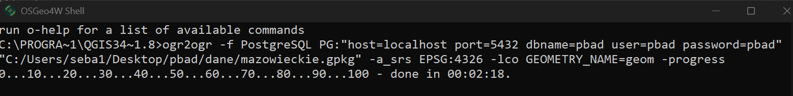
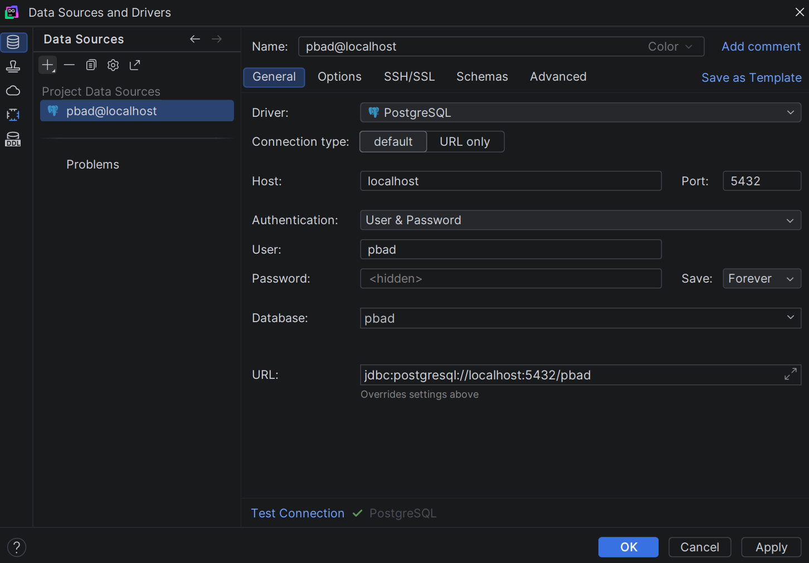
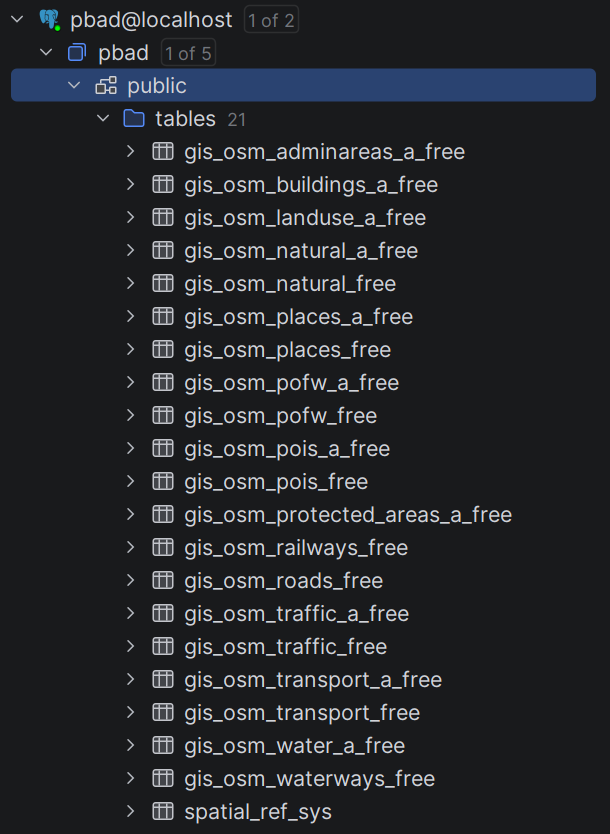

# Ładowanie danych testowych

Dane testowe to dane z OpenStreetMap dla województwa mazowieckiego. Ładujemy je do PostgreSQL narzędziem `ogr2ogr`, które instaluje się razem z QGIS.

## Jak wyglądają dane

Geofabrik udostępnia w wersji free dane OSM wstępnie przetworzone. Obiekty są podzielone na warstwy tematyczne (np. POI, drogi, transport, granice administracyjne), a typ obiektu jest zapisany w jednej kolumnie `fclass`. Tabele z `_a` w nazwie (np. `gis_osm_pois_a_free`) zawierają obszary (poligony), a te bez niego (np. `gis_osm_pois_free`) punkty albo linie. Szczegóły: https://download.geofabrik.de/osm-data-in-gis-formats-free.pdf

## 1. Pobranie danych

1. Wejdź na stronę https://download.geofabrik.de/europe/poland/mazowieckie.html.
2. Pobierz plik `mazowieckie-latest-free.gpkg.zip` (dane OpenStreetMap dla województwa mazowieckiego w formacie GeoPackage).
3. Rozpakuj archiwum. W środku jest plik `mazowieckie.gpkg`.

## 2. Uruchomienie bazy danych

W folderze `docker` uruchom bazę:

```bash
cd docker
docker compose up -d
```

## 3. Import danych do PostgreSQL

Razem z QGIS instaluje się aplikacja **OSGeo4W Shell**. Uruchom ją i wykonaj polecenie:

```bat
ogr2ogr -f PostgreSQL PG:"host=localhost port=5432 dbname=pbad user=pbad password=pbad" "SCIEZKA_DO_PLIKU\mazowieckie.gpkg" -a_srs EPSG:4326 -lco GEOMETRY_NAME=geom -progress
```

W miejsce `SCIEZKA_DO_PLIKU\mazowieckie.gpkg` wpisz pełną ścieżkę do rozpakowanego pliku, np. `"C:\Users\ja\Downloads\mazowieckie.gpkg"`. Zostaw cudzysłowy, bo bez nich polecenie nie zadziała, jeśli w ścieżce są spacje.

U mnie to polecenie wyglądało tak (import trwał ok. 2 minut):



## 4. Połączenie z DataGrip



## 5. Podgląd tabel


